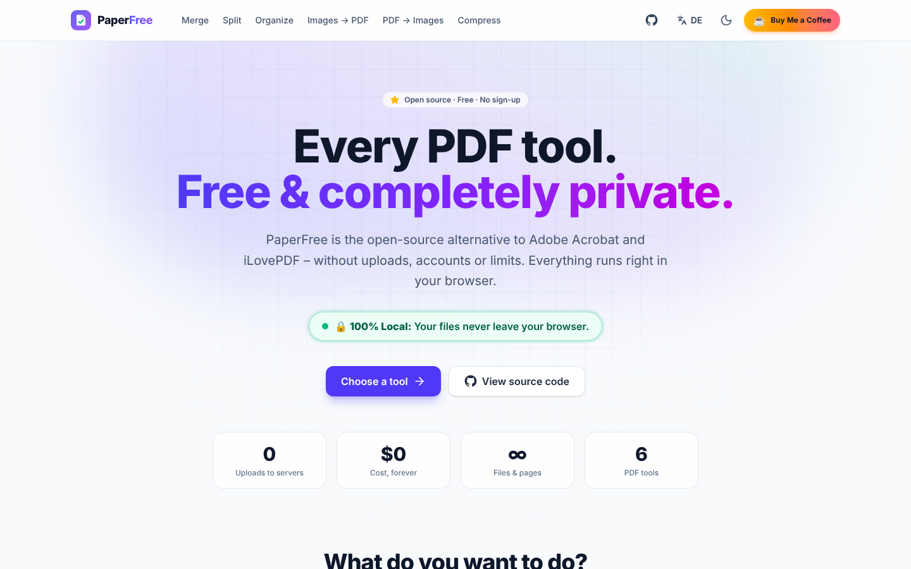
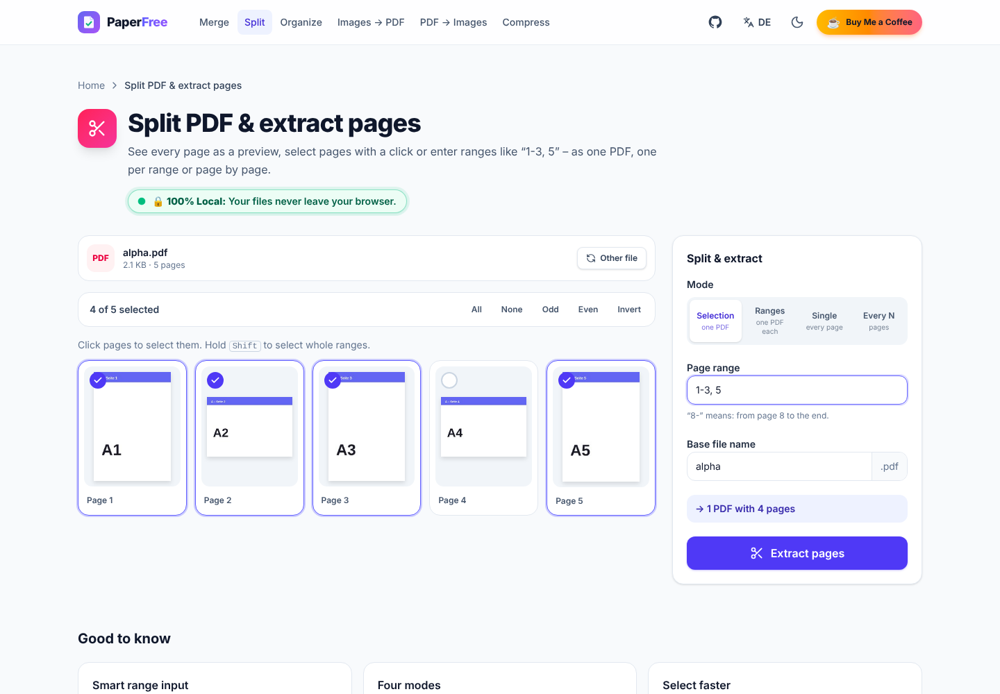
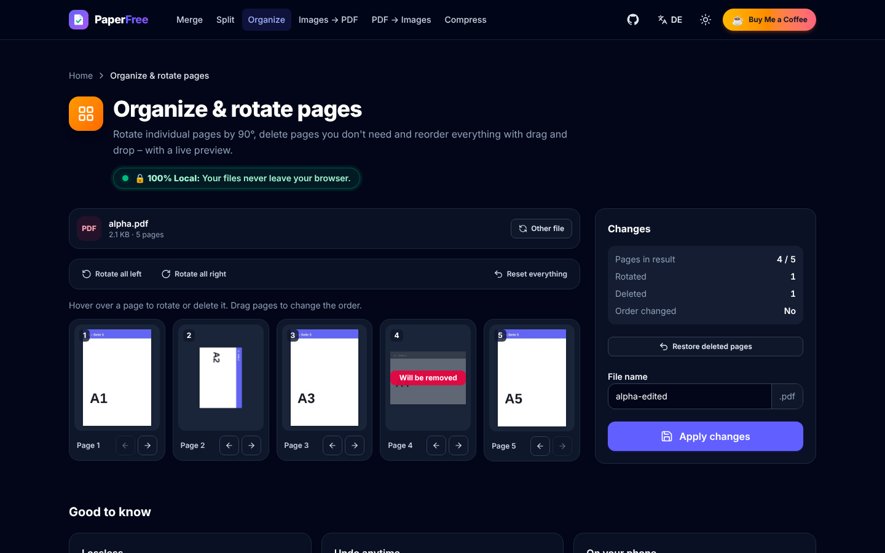
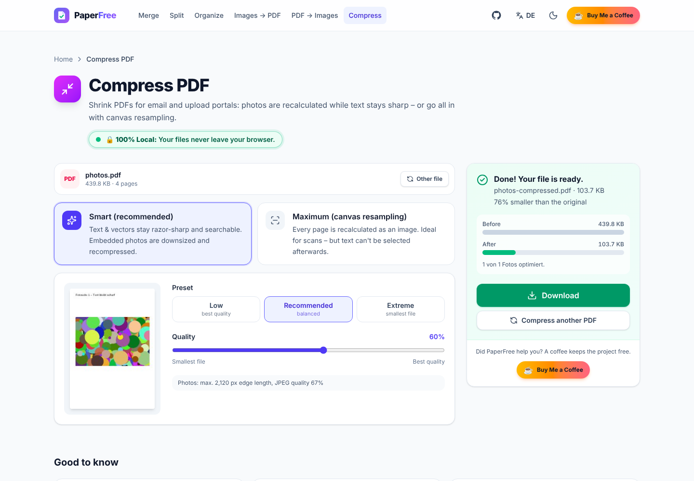
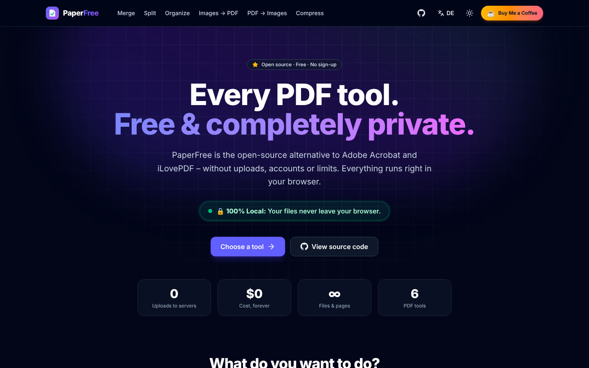

<div align="center">


# PaperFree

**English** · [Deutsch](README.de.md)

### Every PDF tool. Free. And completely private.

**The open-source alternative to Adobe Acrobat and iLovePDF – without uploads, accounts or limits.**
Merge, split, rotate, compress and convert PDFs to images: all **100% locally in your browser**.

[](LICENSE)
[](https://nextjs.org)
[](https://www.typescriptlang.org)
[](https://ko-fi.com/cind3rbyte)

[**🚀 Live demo**](https://paperfree-mu.vercel.app) · [**☕ Support the project**](https://ko-fi.com/cind3rbyte) · [**🐛 Report a bug**](https://github.com/cind3rbyte/paperfree/issues)

[](https://vercel.com/new/clone?repository-url=https%3A%2F%2Fgithub.com%2Fcind3rbyte%2Fpaperfree&project-name=paperfree&repository-name=paperfree)

</div>

---

> ### 🔒 100% Local: Your files never leave your browser.
>
> Classic online PDF services upload your contracts, bank statements and medical letters to someone else's servers.
> PaperFree flips that around: **the software comes to your files – not the other way round.**
> A strict Content Security Policy even makes uploads technically impossible.



## ✨ Why PaperFree?

|     | Benefit                   | What it means for you                                                                          |
| --- | ------------------------- | ---------------------------------------------------------------------------------------------- |
| 🔒  | **Privacy by design**     | No uploads, no cookies, no tracking. Ideal for GDPR-sensitive documents.                        |
| ⚡  | **Instant**               | No uploading, no queue. Processing starts the moment you drop in a file.                        |
| ♾️  | **No limits**             | No limits on file size, page count or tasks per day. The only limit is your device.             |
| 👤  | **No account**            | No sign-up, no email address, no subscription trap.                                             |
| 🧾  | **No watermarks**         | Clean results without branding or ad banners.                                                   |
| 🌍  | **English & German**      | Switch languages with one click – the browser language is detected automatically.              |
| 🧑‍💻  | **Open source (MIT)**     | Audit every line yourself – or run your own instance for your firm, practice or company.        |

## 🧰 Tools

| Tool                                  | Features                                                                                                                       |
| ------------------------------------- | ------------------------------------------------------------------------------------------------------------------------------ |
| **📎 Merge PDF**                      | Any number of PDFs via drag and drop, reorder by dragging, arrow buttons or natural sorting by name                            |
| **✂️ Split PDF & extract pages**      | Preview grid of all pages, ranges like `1-3, 5, 8-`, shift-click selection, 4 modes (selection, ranges, single pages, every N pages), ZIP export |
| **🔄 Organize & rotate pages**        | Rotate pages by 90°, delete & restore, reorder with drag and drop – lossless                                                    |
| **🖼️ Images to PDF**                  | PNG, JPG, WebP (also GIF, BMP, AVIF), A4 / US Letter / image size, orientation, margins, rotation per image, EXIF correction    |
| **🗂️ PDF to images**                  | Pages as PNG or JPG at 72–300 DPI, single-page download, all pages as `.zip`                                                   |
| **🗜️ Compress PDF**                   | Quality slider 10–100%, **smart mode** (text stays sharp, only photos are recalculated) or **maximum mode** (canvas resampling, optional grayscale), before/after comparison |

<table>
  <tr>
    <td></td>
    <td></td>
  </tr>
  <tr>
    <td></td>
    <td></td>
  </tr>
</table>

## ⚖️ PaperFree compared

| Feature                            | **PaperFree**                         | Adobe Acrobat                                       | iLovePDF                                 |
| ---------------------------------- | ------------------------------------- | --------------------------------------------------- | ---------------------------------------- |
| Price                              | ✅ **Free, forever**                  | ❌ Subscription for the full feature set            | ➖ Free with limits, paid Premium        |
| Files stay on your device          | ✅ **100% local in your browser**     | ➖ Desktop is local, online tools upload to the cloud | ❌ Web version uploads to servers      |
| Usable without an account          | ✅ **Yes**                            | ➖ Many features require an account                 | ✅ Yes, for basic features               |
| No file or daily limits            | ✅ **Only limited by your device**    | ➖ Free usage is restricted                         | ➖ Free version has limits               |
| Open source & self-hostable        | ✅ **MIT, one-click Vercel deploy**   | ❌ Proprietary                                      | ❌ Proprietary                           |
| Merge, split, rotate               | ✅                                    | ✅                                                  | ✅                                       |
| Compress & PDF ↔ images            | ✅                                    | ✅                                                  | ✅                                       |
| Edit text, OCR, sign               | 🔜 Roadmap                            | ✅                                                  | ➖ Partly (Premium)                      |

<sub>As of 2026. Information about third-party providers without guarantee; features and prices may change. Adobe, Acrobat and iLovePDF are trademarks of their respective owners.</sub>

## ☕ Support PaperFree

PaperFree is **free, ad-free and has no premium tier** – and it's going to stay that way.
If the project saves you time, money or nerves, I'd be thrilled about a coffee:

<div align="center">

[](https://ko-fi.com/cind3rbyte)

</div>

**Every donation goes straight into new features:** OCR, digital signatures, text editing, watermarks, password protection and an installable offline app.
No money to spare? A ⭐ **star on GitHub** helps just as much – it makes PaperFree visible to others.

## 🚀 Quick start

**Requirements:** Node.js ≥ 18.18 (recommended: 20 LTS or newer)

```bash
git clone https://github.com/cind3rbyte/paperfree.git
```

```bash
cd paperfree
```

```bash
npm install
```

```bash
npm run dev
```

Then open [http://localhost:3000](http://localhost:3000) – you'll be redirected to `/en` or `/de` depending on your browser language.

| Command             | Description                                                    |
| ------------------- | -------------------------------------------------------------- |
| `npm run dev`       | Development server with hot reload                             |
| `npm run build`     | Optimized production build (incl. lint & type check)           |
| `npm run start`     | Start the production server                                    |
| `npm run lint`      | Run ESLint                                                     |
| `npm run typecheck` | TypeScript check without a build                               |

> `npm install` automatically copies the pdf.js worker plus CMaps, standard fonts and WASM decoders to `public/pdfjs/` (see `scripts/copy-pdfjs-assets.mjs`). Everything is served from your own domain – no CDN.

## ▲ Deploying to Vercel

1. Fork or push the repository to GitHub.
2. Import it at [vercel.com/new](https://vercel.com/new) – the "Next.js" framework is detected automatically.
3. Optionally set the environment variables below and click **Deploy**. Done.

Or with one click: [](https://vercel.com/new/clone?repository-url=https%3A%2F%2Fgithub.com%2Fcind3rbyte%2Fpaperfree&project-name=paperfree&repository-name=paperfree)

Since PaperFree has no backend, it stays free forever even on the Hobby plan – every page is statically pre-rendered in both languages.

### Configuration

Copy `.env.example` to `.env.local` (locally) or add the variables in the Vercel dashboard:

| Variable                 | Description                                                  | Default                                      |
| ------------------------ | ------------------------------------------------------------ | -------------------------------------------- |
| `NEXT_PUBLIC_SITE_URL`   | Public URL (SEO, sitemap, Open Graph image)                  | Vercel production URL or `localhost:3000`    |
| `NEXT_PUBLIC_GITHUB_URL` | Link to your repository (header, footer, home page)          | `https://github.com/cind3rbyte/paperfree`    |
| `NEXT_PUBLIC_KOFI_URL`   | Target of the "☕ Buy Me a Coffee" button                     | `https://ko-fi.com/cind3rbyte`               |
| `NEXT_PUBLIC_BMC_URL`    | Optional extra Buy Me a Coffee link in the footer            | empty (button hidden)                        |

All values come together in [`lib/site-config.ts`](lib/site-config.ts).

## 🌍 Languages

PaperFree ships in **English** (default) and **German**:

- Every page exists under `/en/…` and `/de/…` and is pre-rendered statically, with `hreflang` alternates for search engines.
- `middleware.ts` redirects `/` (and old paths like `/merge`) to the visitor's browser language – **without setting a cookie**.
- The language switcher in the header keeps you on the same page.
- All texts live in [`lib/i18n/dictionaries`](lib/i18n/dictionaries). To add a language, copy `en.ts`, translate it (TypeScript makes sure no key is missing) and add the code to `locales` in [`lib/i18n/config.ts`](lib/i18n/config.ts).

## 🛡️ How privacy works under the hood

```text
 Your file ──► Browser memory ──► pdf-lib / pdf.js (web worker, WASM) ──► Blob ──► Download
                    ▲                                                                 │
                    └─────────────────── nothing leaves your device ◄─────────────────┘
```

- **No backend:** there's no API route that accepts files. All pages are static.
- **pdf-lib** handles structural operations (merge, split, rotate, embed images, replace image streams).
- **pdf.js** renders pages for previews, image export and canvas resampling – in a web worker served from your own domain.
- **JSZip** bundles multiple results into a ZIP archive locally.
- **Content Security Policy** in production (`next.config.ts`): `connect-src 'self'` technically blocks every connection to third-party servers; `frame-ancestors 'none'`, `object-src 'none'` and more harden the page further.
- **No cookies, no analytics, no external fonts at runtime** (Inter is self-hosted at build time via `next/font`).

**Check it yourself:** open the developer tools (F12) → "Network" tab → edit a PDF. You won't see a single upload.

## 🗂️ Project structure

```text
paperfree/
├── app/
│   ├── [locale]/
│   │   ├── layout.tsx          # Root layout per language: <html lang>, header, footer, metadata
│   │   ├── page.tsx            # Home: hero, tools, comparison, FAQ, donation call
│   │   ├── merge/ · split/ · organize/ · images-to-pdf/ · pdf-to-images/ · compress/
│   │   ├── opengraph-image.tsx # Localized social preview image
│   │   └── not-found.tsx       # Localized 404 page
│   ├── globals.css             # Tailwind CSS v4 + dark mode variant
│   ├── manifest.ts · robots.ts · sitemap.ts · icon.svg · not-found.tsx
├── components/
│   ├── Header.tsx · Footer.tsx · LanguageSwitcher.tsx · ThemeToggle.tsx · Logo.tsx
│   ├── PrivacyBadge.tsx · KofiButton.tsx · GithubIcon.tsx
│   ├── Dropzone.tsx            # Drag and drop with validation & progress bar
│   ├── ToolCard.tsx · ToolShell.tsx · FileDropGuard.tsx
│   ├── home/                   # Comparison table
│   ├── tools/                  # The six tools + shared building blocks
│   └── ui/                     # Button, Card, Alert, ProgressBar, SegmentedControl
├── hooks/
│   ├── usePdfThumbnails.ts     # Progressive page thumbnails
│   ├── useDragReorder.ts       # Native drag and drop for reordering
│   └── useTaskRunner.ts        # Status, progress & errors of an operation
├── lib/
│   ├── pdf-utils.ts            # 🧠 The complete PDF engine (pdf-lib, pdf.js, JSZip)
│   ├── i18n/                   # Locales, dictionaries (en, de), provider, metadata helpers
│   ├── tools.ts                # Tool metadata (icons, colors, routes)
│   ├── site-config.ts          # Name, URLs, donation links
│   └── utils.ts                # Helpers (file names, downloads, formatting)
├── middleware.ts               # Browser language detection for / → /en or /de
├── scripts/copy-pdfjs-assets.mjs
├── next.config.ts              # Security headers & Content Security Policy
└── .github/workflows/ci.yml    # Lint, type check & build on every push
```

## 🧠 Under the hood: `lib/pdf-utils.ts`

| Function                  | Description                                                                                            |
| ------------------------- | ------------------------------------------------------------------------------------------------------ |
| `mergePdfs`               | Copies all pages of several documents into a new PDF (metadata of the first file is kept)              |
| `parsePageRanges`         | Understands `1-3, 5`, open ranges (`8-`, `-4`) and descending ranges (`5-3`), including validation      |
| `formatPageRanges`        | Compacts selections: `[1,2,3,5]` → `1-3, 5`                                                            |
| `extractPages`/`splitPdf` | Extracts pages or creates several documents from page groups                                           |
| `organizePdf`             | New order, rotation (`/Rotate`) and deletion in one step – lossless                                     |
| `imagesToPdf`             | Embeds PNG/JPG losslessly, converts WebP & co. via canvas, fixes EXIF orientation                       |
| `renderPdfToImages`       | Renders pages at a chosen DPI as PNG/JPG – protected against canvas size limits (iOS Safari)            |
| `compressPdf`             | **Smart:** replaces embedded JPEG streams with downsized versions · **Raster:** canvas resampling per page |
| `renderThumbnails`        | Progressive previews, cancellable via `AbortSignal`                                                     |
| `createZip`               | Bundles results with unique file names                                                                  |

## 🗺️ Roadmap

- [x] Merge, split, organize & rotate
- [x] Images ↔ PDF, compress with quality slider
- [x] Dark/light mode, mobile-optimized, strict CSP
- [x] English & German with automatic language detection
- [ ] Password-protect / unlock PDFs
- [ ] Add watermarks & page numbers
- [ ] Draw and insert a digital signature
- [ ] OCR for scanned documents – locally via WebAssembly
- [ ] Installable offline app (PWA with service worker)
- [ ] More languages

Want to help decide what comes next? [Vote in the issues](https://github.com/cind3rbyte/paperfree/issues) – or [speed things up with a coffee](https://ko-fi.com/cind3rbyte). ☕

## 🤝 Contributing

Contributions are very welcome!

1. Fork the repository and create a branch: `git checkout -b feature/my-feature`
2. Check your changes with `npm run lint`, `npm run typecheck` and `npm run build`.
3. Open a pull request with a short description and – for UI changes – a screenshot.

**Golden rule:** no feature may send user files to a server. The Content Security Policy must not be loosened.

## 📄 License

[MIT](LICENSE) – use, modify and distribute PaperFree freely, including commercially.

Built with [Next.js](https://nextjs.org), [Tailwind CSS](https://tailwindcss.com), [pdf-lib](https://pdf-lib.js.org), [pdf.js](https://mozilla.github.io/pdf.js/), [JSZip](https://stuk.github.io/jszip/) and [Lucide](https://lucide.dev).

<div align="center">

**If PaperFree helped you: [☕ Buy me a coffee](https://ko-fi.com/cind3rbyte) · [⭐ Star the project](https://github.com/cind3rbyte/paperfree)**

</div>
