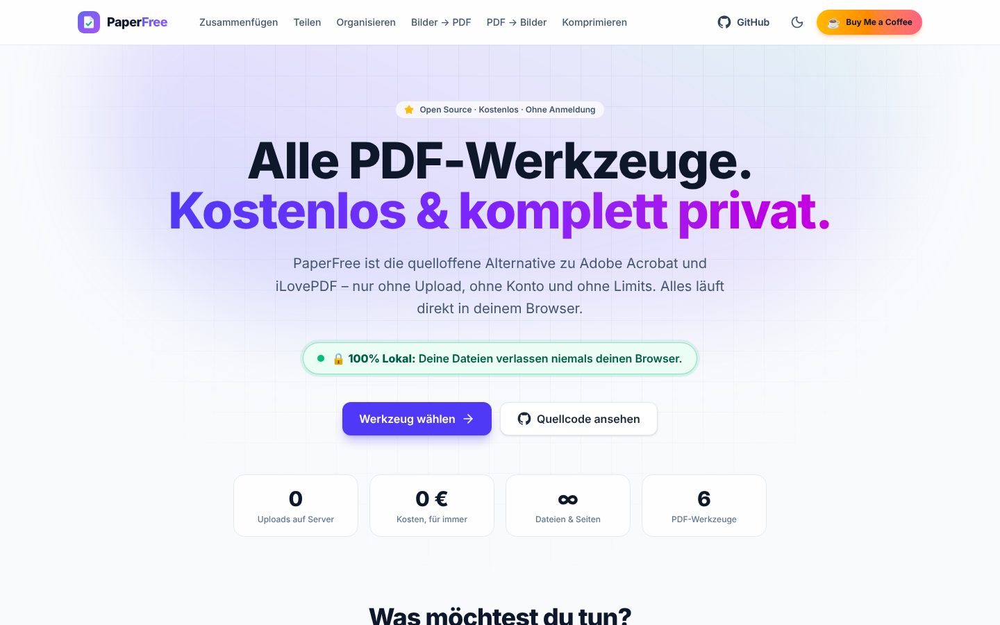
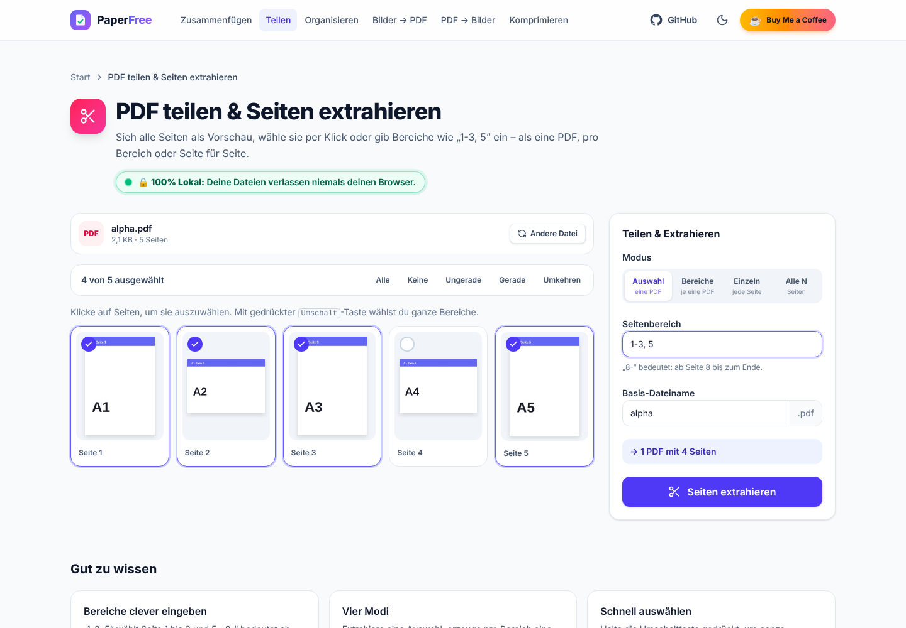
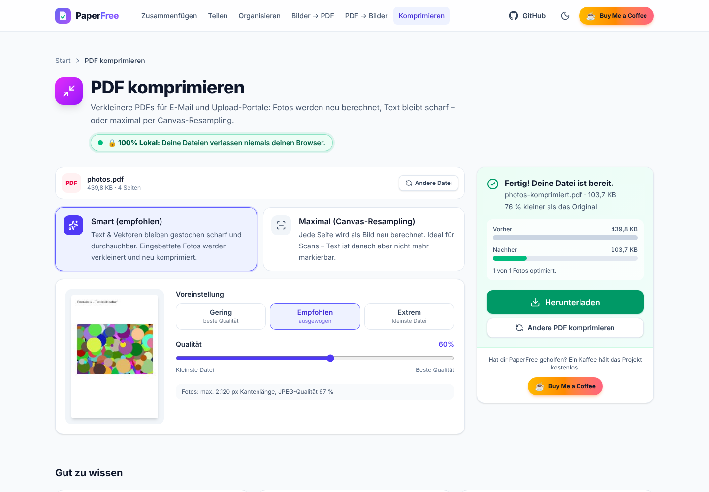
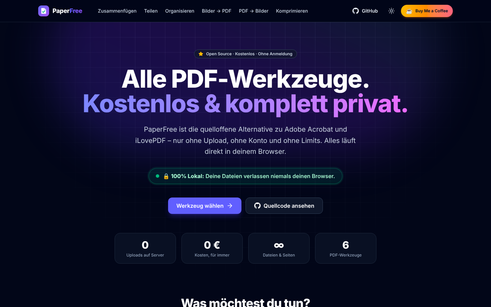

<div align="center">


# PaperFree

### Alle PDF-Werkzeuge. Kostenlos. Und komplett privat.

**Die quelloffene Alternative zu Adobe Acrobat und iLovePDF – ohne Upload, ohne Konto, ohne Limits.**
PDFs zusammenfügen, teilen, drehen, komprimieren und in Bilder umwandeln: alles **zu 100 % lokal in deinem Browser**.

[](LICENSE)
[](https://nextjs.org)
[](https://www.typescriptlang.org)
[](https://ko-fi.com/cind3rbyte)

[**🚀 Live-Demo**](https://paperfree.example.com) · [**☕ Projekt unterstützen**](https://ko-fi.com/cind3rbyte) · [**🐛 Fehler melden**](https://github.com/cind3rbyte/paperfree/issues)

[](https://vercel.com/new/clone?repository-url=https%3A%2F%2Fgithub.com%2Fcind3rbyte%2Fpaperfree&project-name=paperfree&repository-name=paperfree)

</div>

---

> ### 🔒 100% Lokal: Deine Dateien verlassen niemals deinen Browser.
>
> Klassische Online-PDF-Dienste laden deine Verträge, Kontoauszüge und Arztbriefe auf fremde Server.
> PaperFree dreht das Prinzip um: **Die Software kommt zu deinen Dateien – nicht umgekehrt.**
> Eine strikte Content-Security-Policy macht Uploads sogar technisch unmöglich.



## ✨ Warum PaperFree?

|     | Vorteil                         | Was das für dich bedeutet                                                                             |
| --- | ------------------------------- | ----------------------------------------------------------------------------------------------------- |
| 🔒  | **Privatsphäre by Design**      | Keine Uploads, keine Cookies, kein Tracking. Ideal für DSGVO-sensible Dokumente.                       |
| ⚡  | **Sofort startklar**            | Kein Hochladen, keine Warteschlange. Die Verarbeitung beginnt, sobald du die Datei hineinziehst.       |
| ♾️  | **Keine Limits**                | Keine Begrenzung bei Dateigröße, Seitenzahl oder Aufgaben pro Tag. Die einzige Grenze ist dein Gerät. |
| 👤  | **Kein Konto**                  | Keine Registrierung, keine E-Mail-Adresse, keine Abo-Falle.                                           |
| 🧾  | **Ohne Wasserzeichen**          | Saubere Ergebnisse ohne Branding und ohne Werbebanner.                                                |
| 🧑‍💻  | **Open Source (MIT)**           | Prüfe jede Zeile Code selbst – oder betreibe deine eigene Instanz für Kanzlei, Praxis oder Firma.      |

## 🧰 Werkzeuge

| Werkzeug                                  | Funktionen                                                                                                       |
| ----------------------------------------- | ---------------------------------------------------------------------------------------------------------------- |
| **📎 PDF zusammenfügen**                  | Beliebig viele PDFs per Drag-and-Drop, Reihenfolge per Ziehen, Pfeiltasten oder natürliche Sortierung nach Namen |
| **✂️ PDF teilen & Seiten extrahieren**    | Vorschau-Raster aller Seiten, Bereiche wie `1-3, 5, 8-`, Shift-Klick-Auswahl, 4 Modi (Auswahl, Bereiche, Einzelseiten, alle N Seiten), ZIP-Export |
| **🔄 Seiten organisieren & drehen**       | Seiten um 90° drehen, löschen & wiederherstellen, per Drag-and-Drop neu anordnen – verlustfrei                    |
| **🖼️ Bilder zu PDF**                      | PNG, JPG, WebP (auch GIF, BMP, AVIF), A4 / US Letter / Bildgröße, Ausrichtung, Ränder, Drehung pro Bild, EXIF-Korrektur |
| **🗂️ PDF zu Bildern**                     | Seiten als PNG oder JPG in 72–300 DPI, Einzelseiten-Download, alle Seiten als `.zip`                             |
| **🗜️ PDF komprimieren**                   | Qualitätsregler 10–100 %, **Smart-Modus** (Text bleibt scharf, nur Fotos werden neu berechnet) oder **Maximal-Modus** (Canvas-Resampling, optional Graustufen), Vorher/Nachher-Vergleich |

<table>
  <tr>
    <td></td>
    <td></td>
  </tr>
  <tr>
    <td></td>
    <td></td>
  </tr>
</table>

## ⚖️ PaperFree im Vergleich

| Funktion                                | **PaperFree**                     | Adobe Acrobat                                   | iLovePDF                                  |
| --------------------------------------- | --------------------------------- | ----------------------------------------------- | ----------------------------------------- |
| Preis                                   | ✅ **Kostenlos, für immer**       | ❌ Abo für den vollen Funktionsumfang           | ➖ Gratis mit Limits, Premium kostenpflichtig |
| Dateien bleiben auf deinem Gerät        | ✅ **100 % lokal im Browser**     | ➖ Desktop lokal, Online-Tools mit Cloud-Upload | ❌ Web-Version lädt auf Server hoch       |
| Ohne Konto nutzbar                      | ✅ **Ja**                         | ➖ Viele Funktionen erfordern ein Konto         | ✅ Ja, für Basisfunktionen                |
| Keine Datei- oder Tageslimits           | ✅ **Nur durch dein Gerät begrenzt** | ➖ Gratis-Nutzung eingeschränkt              | ➖ Gratis-Version mit Limits              |
| Open Source & selbst hostbar            | ✅ **MIT, 1-Klick auf Vercel**    | ❌ Proprietär                                   | ❌ Proprietär                             |
| Zusammenfügen, Teilen, Drehen           | ✅                                | ✅                                              | ✅                                        |
| Komprimieren & PDF ↔ Bilder             | ✅                                | ✅                                              | ✅                                        |
| Text bearbeiten, OCR, Signieren         | 🔜 Roadmap                        | ✅                                              | ➖ Teilweise (Premium)                    |

<sub>Stand: 2026. Angaben zu Drittanbietern ohne Gewähr; Funktionen und Preise können sich ändern. Adobe, Acrobat und iLovePDF sind Marken ihrer jeweiligen Inhaber.</sub>

## ☕ Unterstütze PaperFree

PaperFree ist **kostenlos, werbefrei und ohne Premium-Stufe** – und das soll so bleiben.
Wenn dir das Projekt Zeit, Geld oder Nerven spart, freue ich mich riesig über einen Kaffee:

<div align="center">

[](https://ko-fi.com/cind3rbyte)

</div>

**Jede Spende fließt direkt in neue Funktionen:** OCR, digitale Signaturen, Text-Bearbeitung, Wasserzeichen, Passwortschutz und eine installierbare Offline-App.
Kein Geld übrig? Ein ⭐ **Stern auf GitHub** hilft genauso – er macht PaperFree für andere sichtbar.

## 🚀 Schnellstart

**Voraussetzungen:** Node.js ≥ 18.18 (empfohlen: 20 LTS oder neuer)

```bash
git clone https://github.com/cind3rbyte/paperfree.git
```

```bash
cd paperfree
```

```bash
npm install
```

```bash
npm run dev
```

Öffne anschließend [http://localhost:3000](http://localhost:3000).

| Befehl              | Beschreibung                                                     |
| ------------------- | ---------------------------------------------------------------- |
| `npm run dev`       | Entwicklungsserver mit Hot-Reload                                |
| `npm run build`     | Optimierter Produktions-Build (inkl. Lint & Typprüfung)          |
| `npm run start`     | Produktionsserver starten                                        |
| `npm run lint`      | ESLint ausführen                                                 |
| `npm run typecheck` | TypeScript-Prüfung ohne Build                                    |

> `npm install` kopiert automatisch den pdf.js-Worker samt CMaps, Standard-Schriften und WASM-Decodern nach `public/pdfjs/` (siehe `scripts/copy-pdfjs-assets.mjs`). So wird alles von deiner eigenen Domain ausgeliefert – ohne CDN.

## ▲ Deployment auf Vercel

1. Repository auf GitHub forken bzw. pushen.
2. Auf [vercel.com/new](https://vercel.com/new) importieren – Framework „Next.js“ wird automatisch erkannt.
3. Optional die Umgebungsvariablen unten setzen und auf **Deploy** klicken. Fertig.

Oder direkt per Klick: [](https://vercel.com/new/clone?repository-url=https%3A%2F%2Fgithub.com%2Fcind3rbyte%2Fpaperfree&project-name=paperfree&repository-name=paperfree)

Da PaperFree kein Backend besitzt, bleibt es auch auf dem kostenlosen Hobby-Tarif dauerhaft gratis – alle Seiten werden statisch vorgerendert.

### Konfiguration

Kopiere `.env.example` nach `.env.local` (lokal) oder trage die Variablen im Vercel-Dashboard ein:

| Variable                 | Beschreibung                                                           | Standard                                      |
| ------------------------ | ---------------------------------------------------------------------- | --------------------------------------------- |
| `NEXT_PUBLIC_SITE_URL`   | Öffentliche URL (SEO, Sitemap, Open-Graph-Bild)                        | Vercel-Produktions-URL bzw. `localhost:3000`  |
| `NEXT_PUBLIC_GITHUB_URL` | Link zu deinem Repository (Header, Footer, Startseite)                 | `https://github.com/cind3rbyte/paperfree`  |
| `NEXT_PUBLIC_KOFI_URL`   | Ziel des „☕ Buy Me a Coffee“-Buttons                                   | `https://ko-fi.com/cind3rbyte`             |
| `NEXT_PUBLIC_BMC_URL`    | Optionaler zusätzlicher Buy-Me-a-Coffee-Link im Footer                 | leer (Button ausgeblendet)                    |

Alle Werte laufen zentral in [`lib/site-config.ts`](lib/site-config.ts) zusammen.

## 🛡️ So funktioniert der Datenschutz technisch

```text
 Deine Datei ──► Browser-Arbeitsspeicher ──► pdf-lib / pdf.js (Web Worker, WASM) ──► Blob ──► Download
                         ▲                                                                       │
                         └──────────────────── nichts verlässt dein Gerät ◄──────────────────────┘
```

- **Kein Backend:** Es gibt keine API-Route, die Dateien entgegennimmt. Alle Seiten sind statisch.
- **pdf-lib** übernimmt Struktur-Operationen (zusammenfügen, teilen, drehen, Bilder einbetten, Bild-Streams ersetzen).
- **pdf.js** rendert Seiten für Vorschauen, Bild-Export und Canvas-Resampling – in einem Web Worker von deiner eigenen Domain.
- **JSZip** bündelt mehrere Ergebnisse lokal zu einem ZIP-Archiv.
- **Content-Security-Policy** in Produktion (`next.config.ts`): `connect-src 'self'` verhindert technisch jede Verbindung zu fremden Servern; `frame-ancestors 'none'`, `object-src 'none'` u. a. härten die Seite zusätzlich ab.
- **Keine Cookies, kein Analytics, keine externen Schriftarten zur Laufzeit** (Inter wird beim Build über `next/font` selbst gehostet).

**Selbst überprüfen:** Öffne die Entwicklertools (F12) → Tab „Netzwerk“ → bearbeite eine PDF. Du wirst keinen einzigen Upload sehen.

## 🗂️ Projektstruktur

```text
paperfree/
├── app/
│   ├── layout.tsx              # Root-Layout: Header, Footer, Theme-Init, Metadaten
│   ├── page.tsx                # Startseite: Hero, Werkzeuge, Vergleich, FAQ, Spendenaufruf
│   ├── globals.css             # Tailwind CSS v4 + Dark-Mode-Variante
│   ├── merge/                  # PDF zusammenfügen
│   ├── split/                  # PDF teilen & Seiten extrahieren
│   ├── organize/               # Seiten organisieren & drehen
│   ├── images-to-pdf/          # Bilder zu PDF
│   ├── pdf-to-images/          # PDF zu Bildern
│   ├── compress/               # PDF komprimieren
│   ├── opengraph-image.tsx     # Dynamisches Social-Media-Vorschaubild
│   ├── manifest.ts · robots.ts · sitemap.ts · icon.svg · not-found.tsx
├── components/
│   ├── Header.tsx · Footer.tsx · ThemeToggle.tsx · Logo.tsx
│   ├── PrivacyBadge.tsx · KofiButton.tsx · GithubIcon.tsx
│   ├── Dropzone.tsx            # Drag-and-Drop mit Validierung & Ladebalken
│   ├── ToolCard.tsx · ToolShell.tsx · FileDropGuard.tsx
│   ├── home/                   # Vergleichstabelle & FAQ-Inhalte
│   ├── tools/                  # Die sechs Werkzeuge + gemeinsame Bausteine
│   └── ui/                     # Button, Card, Alert, ProgressBar, SegmentedControl
├── hooks/
│   ├── usePdfThumbnails.ts     # Progressives Rendern von Seitenvorschauen
│   ├── useDragReorder.ts       # Natives Drag-and-Drop zum Umsortieren
│   └── useTaskRunner.ts        # Status, Fortschritt & Fehler einer Operation
├── lib/
│   ├── pdf-utils.ts            # 🧠 Die komplette PDF-Engine (pdf-lib, pdf.js, JSZip)
│   ├── tools.ts                # Metadaten aller Werkzeuge
│   ├── site-config.ts          # Name, URLs, Spendenlinks
│   └── utils.ts                # Hilfsfunktionen (Dateinamen, Downloads, Formatierung)
├── scripts/copy-pdfjs-assets.mjs
├── next.config.ts              # Security-Header & Content-Security-Policy
└── .github/workflows/ci.yml    # Lint, Typecheck & Build bei jedem Push
```

## 🧠 Unter der Haube: `lib/pdf-utils.ts`

| Funktion                 | Beschreibung                                                                                       |
| ------------------------ | -------------------------------------------------------------------------------------------------- |
| `mergePdfs`              | Kopiert alle Seiten mehrerer Dokumente in ein neues PDF (Metadaten der ersten Datei bleiben erhalten) |
| `parsePageRanges`        | Versteht `1-3, 5`, offene Bereiche (`8-`, `-4`) und absteigende Bereiche (`5-3`) inkl. Validierung |
| `formatPageRanges`       | Fasst Auswahlen kompakt zusammen: `[1,2,3,5]` → `1-3, 5`                                           |
| `extractPages`/`splitPdf`| Extrahiert Seiten bzw. erzeugt mehrere Dokumente aus Seitengruppen                                 |
| `organizePdf`            | Neue Reihenfolge, Drehung (`/Rotate`) und Löschen in einem Schritt – verlustfrei                   |
| `imagesToPdf`            | Bettet PNG/JPG verlustfrei ein, konvertiert WebP & Co. per Canvas, korrigiert die EXIF-Ausrichtung |
| `renderPdfToImages`      | Rendert Seiten in wählbarer DPI als PNG/JPG – mit Schutz vor Canvas-Größenlimits (iOS Safari)      |
| `compressPdf`            | **Smart:** ersetzt eingebettete JPEG-Streams durch verkleinerte Versionen · **Raster:** Canvas-Resampling jeder Seite |
| `renderThumbnails`       | Progressive Vorschauen, abbrechbar per `AbortSignal`                                               |
| `createZip`              | Bündelt Ergebnisse mit eindeutigen Dateinamen                                                      |

## 🗺️ Roadmap

- [x] Zusammenfügen, Teilen, Organisieren & Drehen
- [x] Bilder ↔ PDF, Komprimieren mit Qualitätsregler
- [x] Dark/Light-Mode, Mobile-optimiert, strikte CSP
- [ ] PDF mit Passwort schützen / entsperren
- [ ] Wasserzeichen & Seitenzahlen hinzufügen
- [ ] Digitale Signatur zeichnen und einfügen
- [ ] OCR (Texterkennung) für gescannte Dokumente – lokal per WebAssembly
- [ ] Installierbare Offline-App (PWA mit Service Worker)
- [ ] Englische Übersetzung (i18n)

Du willst mitentscheiden, was als Nächstes kommt? [Stimme in den Issues ab](https://github.com/cind3rbyte/paperfree/issues) – oder [beschleunige die Entwicklung mit einem Kaffee](https://ko-fi.com/cind3rbyte). ☕

## 🤝 Mitmachen

Beiträge sind herzlich willkommen!

1. Forke das Repository und erstelle einen Branch: `git checkout -b feature/mein-feature`
2. Prüfe deine Änderungen mit `npm run lint`, `npm run typecheck` und `npm run build`.
3. Öffne einen Pull Request mit einer kurzen Beschreibung und – bei UI-Änderungen – einem Screenshot.

**Goldene Regel:** Keine Funktion darf Nutzerdateien an einen Server senden. Die Content-Security-Policy darf nicht aufgeweicht werden.

## 📄 Lizenz

[MIT](LICENSE) – nutze, verändere und verteile PaperFree frei, auch kommerziell.

Gebaut mit [Next.js](https://nextjs.org), [Tailwind CSS](https://tailwindcss.com), [pdf-lib](https://pdf-lib.js.org), [pdf.js](https://mozilla.github.io/pdf.js/), [JSZip](https://stuk.github.io/jszip/) und [Lucide](https://lucide.dev).

<div align="center">

**Wenn PaperFree dir geholfen hat: [☕ Spendier mir einen Kaffee](https://ko-fi.com/cind3rbyte) · [⭐ Gib dem Projekt einen Stern](https://github.com/cind3rbyte/paperfree)**

</div>
